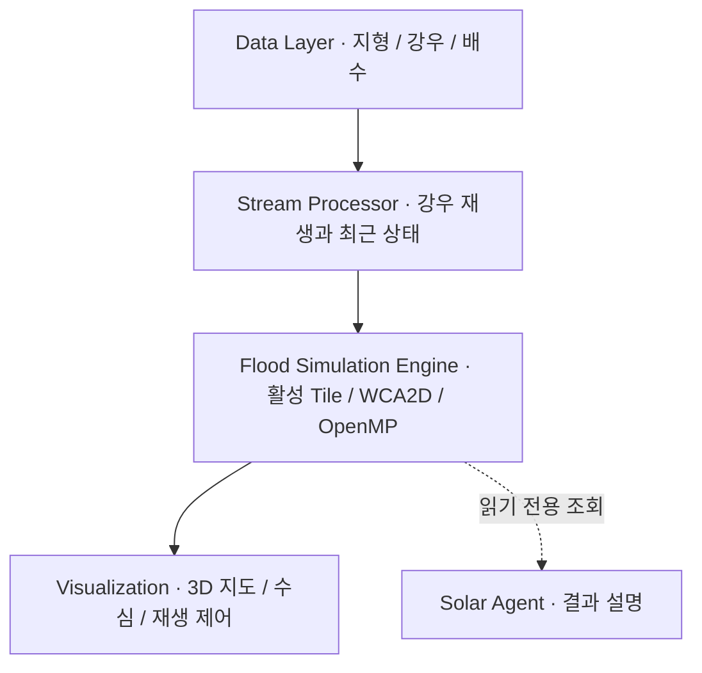

# AntiFlood

## 프로젝트 주제

AntiFlood는 실제 서울 지형과 시간별 강우 관측, 배수 조건을 입력받아 침수 수심의 변화를 계산하고 3D 지도에 표시하는 로컬 시뮬레이션입니다. 강우가 유입되거나 물이 남아 있는 Tile과 인접 영역을 선택해 계산하고, 같은 수심 상태를 시간에 따라 이어 갑니다.

100m Tile은 계산 대상을 관리하며, 물의 이동은 30m 지형 격자에서 계산합니다. 사용자는 대시보드에서 계산 지역과 배수·CPU·경계 조건을 지정하고, 재생을 제어하며 시각별 수심과 선택 위치의 상태를 확인할 수 있습니다. 실행 설정과 결과를 함께 저장해 이전 기록을 다시 열거나 같은 조건으로 재계산할 수 있습니다.

## 프로젝트 동기

도시 침수는 비가 내린 위치만으로 설명하기 어렵습니다. 물은 낮은 곳으로 이동하고 비가 그친 뒤에도 남아 있어, 공간의 연결과 이전 시각의 수심을 함께 다뤄야 합니다.

모든 격자에서 같은 물리 연산을 반복하면 물이 없는 구역에도 계산 자원을 씁니다. 이 프로젝트는 필요한 영역을 선택하면서 Tile 경계에서도 물의 이동과 총량을 유지할 수 있는지 살펴봅니다.

## 시스템 아키텍처



데이터 계층은 좌표와 단위를 맞추고, 스트림 계층은 관측 순서대로 강우를 전달합니다. 계산 엔진은 이전 수심에 강우·배수·이웃 유량을 반영하며 CPU 여러 코어에서 실행합니다.

시각화 계층은 완료된 계산 결과와 시각을 지도에 표시합니다. Solar는 선택적으로 현재 결과를 조회해 설명합니다.

## 리포지토리 폴더 구조

```text
AntiFlood/
├── README.md
├── Launch.cmd             # Windows 대시보드 실행
├── scripts/               # 로컬 서버 시작 스크립트
├── pyproject.toml
├── Dataset/              # 원본 지형·강우와 데이터 출처
│   └── README.md
├── engine/               # WCA2D 커널과 OpenMP 연결 코드
│   └── vendor/wca2d/
├── src/antiflood/         # 데이터 처리·재생·API·Solar
├── web/                  # MapLibre 대시보드
├── outputs/              # 실행별 결과와 로그
│   ├── frames/
│   └── logs/
└── docs/                 # 설계·실행 안내·구현 결정
```

[설치와 실행](docs/RUNNING.md) · [데이터 출처와 범위](Dataset/README.md) · [시스템 아키텍처](docs/ARCHITECTURE.md)
