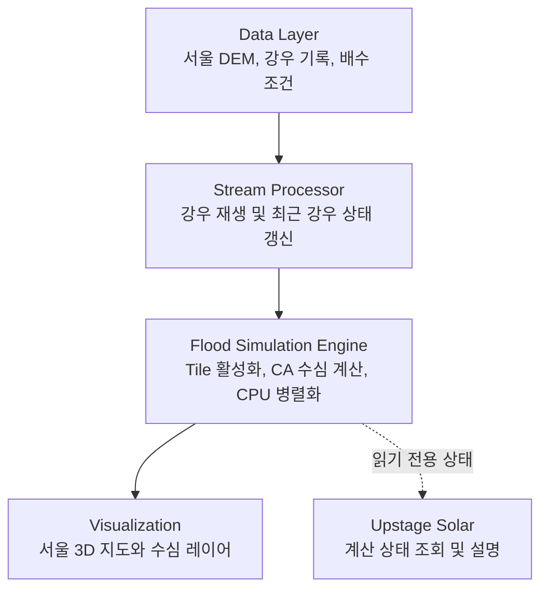

# Anti-Flood

**강우 스트림에 따라 서울의 침수 수심을 갱신하는 적응형 병렬 계산 시스템**

Anti-Flood는 서울의 지형, 시간별 강우량, 지역별 배수 조건을 이용해 물이 어디에 얼마나 고이는지 계산하고 3D 지도에 보여주는 프로젝트입니다. 전체 지역을 매번 똑같이 계산하기보다, 비가 내리거나 물이 이동하는 영역에 계산 자원을 집중하는 것이 핵심입니다.

> 현재 상태: 시스템 구조와 개발 명세를 확정한 단계입니다. 계산 엔진과 웹 화면은 구현 예정입니다.

## 시스템 구조



계산과 시각화는 분리합니다. 지도는 수심을 계산하지 않으며, 계산 엔진이 생성한 결과를 표시합니다.

## 핵심 동작

1. **강우 입력:** 보유한 강우 기록을 관측 시각 순서대로 재생합니다. 최근 강우량은 Sliding Window와 지수 감쇠 요약으로 관리합니다.
2. **계산 영역 선택:** 서울을 **100m × 100m Tile**로 관리합니다. 강우 발생, 기존 수심, 인접 지역에서의 물 유입 가능성을 기준으로 계산 대상을 활성화합니다.
3. **수심 계산:** 기존 공개 **2D Cellular Automata(CA)** 침수 계산 코드를 재사용합니다. 지형 높이, 강우, 배수, 인접 격자 사이의 물 이동을 반영합니다.
4. **병렬 처리:** 하나의 연속된 수심 상태를 노트북의 멀티코어 CPU에서 나누어 계산합니다. Tile 경계에서도 물의 흐름이 이어지도록 처리합니다.
5. **결과 표시:** 계산한 수심을 서울 3D 지형 위에 겹쳐 표시하고, 강우 재생에 따른 변화를 확인합니다.

100m Tile은 **계산 대상을 관리하는 단위**입니다. 실제 물리 계산은 확보한 약 30m DEM 해상도를 기본으로 하며, Tile과 물리 격자는 구분합니다.

## 리포지토리 구조

```text
Anti-Flood/
├── README.md                  # 프로젝트 소개
├── .gitignore                 # 데이터 및 생성 파일 제외 규칙
├── .env.example               # Solar API 환경 변수 예시
├── pyproject.toml             # Python 프로젝트 설정 (구현 단계에서 추가)
│
├── Dataset/                   # 실제 DEM, 강우, 배수 원본 데이터
│   └── README.md              # 데이터 출처 및 구성 설명 (데이터에 맞춰 관리)
│
├── src/
│   └── antiflood/             # Python 애플리케이션
│       ├── data.py            # 지형, 강우, 배수 데이터 로딩 및 정렬
│       ├── stream.py          # 강우 시계열 재생 및 스트림 요약
│       ├── tiles.py           # 100m Tile 관리 및 활성화
│       ├── simulation.py      # CA 엔진 호출 및 수심 상태 관리
│       ├── api.py             # FastAPI 및 재생 제어
│       └── agent.py           # Solar 읽기 전용 상태 설명
│
├── engine/                    # 공개 CA 엔진의 소스, 빌드 및 연동 부분
├── web/                       # 지도 기반 사용자 화면
│   ├── index.html
│   ├── app.js
│   └── style.css
│
├── outputs/                   # 실행 중 생성되는 프레임과 로그
│   ├── frames/
│   └── logs/
│
└── docs/                      # 프로젝트 설계 문서
    ├── ARCHITECTURE.md
    ├── DECISIONS.md
    └── DEVELOPMENT_SPEC.html
```

위 트리는 **확정된 목표 구조**입니다. 현재 없는 코드 파일은 해당 기능을 구현할 때 생성합니다. `Dataset/`에는 기존 데이터를 보존하고, 계산 결과는 `outputs/`에 따로 저장합니다.

| 디렉터리 | 역할 |
|---|---|
| `Dataset/` | 서울 DEM, 강우 관측 기록, 배수 자료와 출처 정보 |
| `src/antiflood/` | 데이터 처리, 스트림, Tile 활성화, 계산 제어, API, 에이전트 |
| `engine/` | 외부 공개 CA 계산 코드와 필요한 최소 연동 코드 |
| `web/` | 3D 지도, 수심 레이어, 시뮬레이션 재생 제어 |
| `outputs/` | 생성된 수심 프레임, 메타데이터, 로그 |
| `docs/` | 확정 아키텍처, 의사결정, 개발 명세 |

## 기술 구성

| 영역 | 기술 |
|---|---|
| 데이터 처리와 백엔드 | Python 3.11, NumPy, Rasterio, FastAPI |
| 침수 계산 | 공개 CA 엔진 재사용, **CADDIES/CAFLOOD WCA2D 우선 검토** |
| 병렬 실행 | CPU 기반 OpenMP 우선 |
| 웹 인터페이스 | HTML, CSS, JavaScript, MapLibre GL JS |
| 보조 에이전트 | Upstage Solar, 계산 상태 조회 전용 |

CA 엔진은 아직 최종 채택하거나 연동한 상태가 아닙니다. 사용할 공개 코드의 라이선스와 연속 계산 및 활성 격자 제어 가능성을 확인한 뒤 `engine/`에 연결합니다. 별도의 멀티노드 클러스터나 GPU는 필수로 요구하지 않습니다.

## 데이터와 실행

이 프로젝트는 `Dataset/`에 준비된 **실제 서울 지형과 강우 자료**를 입력으로 사용합니다. 지역별 배수 자료가 충분하지 않으면 출처가 있는 값을 우선 사용하고, 부족한 부분에는 명시된 가정값을 적용합니다.

현재는 구현 준비 단계이므로 실행 명령을 제공하지 않습니다. 데이터 로더, CA 엔진, 로컬 API가 연결되면 이 섹션에 실제로 작동하는 설치 및 실행 명령을 추가합니다.

## 설계 문서

- [시스템 아키텍처](docs/ARCHITECTURE.md)
- [확정된 결정 사항](docs/DECISIONS.md)
- [개발 명세서](docs/DEVELOPMENT_SPEC.html)

## 범위

Anti-Flood가 계산하는 값은 확보한 지형과 강우 및 배수 조건을 이용한 **근사 수심**입니다. 서울의 실제 침수 수심을 실시간으로 정확히 예측한다고 주장하지 않습니다. 프로젝트는 강우 스트림 처리, 적응형 격자 계산, CPU 병렬화, 3D 시각화에 집중합니다.
