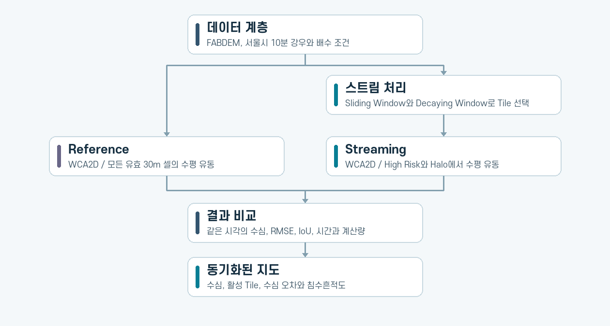

# AntiFlood

## 프로젝트 주제

대규모 시공간 강우 데이터가 지속적으로 유입되는 상황에서, 입력에 의해 변화하는 서울 전역의 침수 상태를 제한된 계산 자원으로 얼마나 빠르게 갱신 가능한가?

## 프로젝트 동기

도시 침수는 특정 지역의 강우량만으로 설명하기 어렵습니다. 빗물은 지형을 따라 주변 지역으로 이동하며, 비가 그친 뒤에도 낮은 지대에 남아 있기 때문입니다.

서울 전역의 침수 상태를 지속적으로 갱신하려면 넓은 지역의 수심과 물의 이동을 반복해서 계산해야 합니다. 그러나 매 순간 모든 격자를 계산하는 방식은 침수와 관계없는 지역에도 계산 자원을 사용합니다.

AntiFlood는 강우와 수심의 변화를 바탕으로 계산이 필요한 지역을 선택하고, 제한된 CPU 자원을 해당 지역에 집중합니다. 이를 통해 전체 영역을 반복 계산하는 방식보다 침수 상태를 얼마나 빠르게 갱신할 수 있는지 확인하고자 합니다.

## 빅데이터 알고리즘의 적용

Sliding Window는 관측소별 최근 10분 강우량 여섯 개를 보관하고 새 관측마다 가장 오래된 값을 빼서 60분 누적량을 갱신합니다. Decaying Window는 이전 점수에 0.8을 곱하고 새 강우량을 더합니다. 같은 관측소를 참조하는 Tile은 이 강우 상태를 공유합니다.

Streaming은 두 Window와 현재 강우, 잔류 수심을 기준으로 100m Tile을 선택합니다. 선택된 Tile의 30m 셀에서 수평 유동을 계산하고, 유효한 수신 셀에는 Tile 상태와 관계없이 유입량을 더합니다. 생략된 수평 유동은 수심의 공간 분포를 바꿀 수 있습니다. 대시보드에서는 전체 유효 셀을 갱신한 Reference와 동일 시각의 배열을 비교해 RMSE와 IoU를 표시합니다.

Tile 선택은 새 10분 입력마다 한 번 하고, 구간 안에서는 비활성 셀로 물이 들어올 때 그 Tile만 추가합니다. 시설 기반 배수로 서울 전역 139개 강우 구간을 계산했을 때, Streaming의 누적 수평 유동 계산량은 50.7% 줄었고 계산 시간은 Reference 71.2초에서 59.3초로 줄었습니다. 마지막 시각의 IoU는 99.1%입니다. [측정 조건과 결과](docs/DECISIONS.md#9-streaming-계산-속도)

## 시스템 아키텍처



두 모드는 하나의 연속된 서울 계산 영역에서 같은 WCA2D 커널을 OpenMP로 실행합니다. 배수는 셀마다 다른 배수능력으로 반영합니다. 서울시 셀은 하수관 설계 강우강도를, 빗물펌프장 주변은 자치구별 펌프 용량을 기준으로 한 추정값이며 실제 배수량 관측값이 아닙니다. 비교 계층은 실행 조건과 시각이 일치하는 결과를 연결합니다. 지도 중심의 대시보드에서 같은 카메라와 시간 막대로 수심, 활성 Tile, 수심 오차, 침수흔적도와 입력 강우, 배수능력, 갱신 시간을 살펴볼 수 있습니다.

## 리파지토리 구조

```text
AntiFlood/
├── Dataset/          # 지형, 강우 데이터와 출처
├── engine/           # WCA2D 계산 엔진 및 OpenMP 연동
├── src/antiflood/    # 데이터 처리, 스트림 처리, API
├── web/              # 3D 지도 대시보드
├── outputs/          # 계산 결과와 실행 기록
├── scripts/          # 실행 스크립트
├── docs/             # 시스템 설계 및 사용 안내
├── Launch.cmd        # Windows 실행기
├── pyproject.toml    # Python 프로젝트 설정
└── README.md
```

[설치 및 실행](docs/RUNNING.md) | [데이터 출처](Dataset/README.md) | [시스템 상세 설계](docs/ARCHITECTURE.md)
