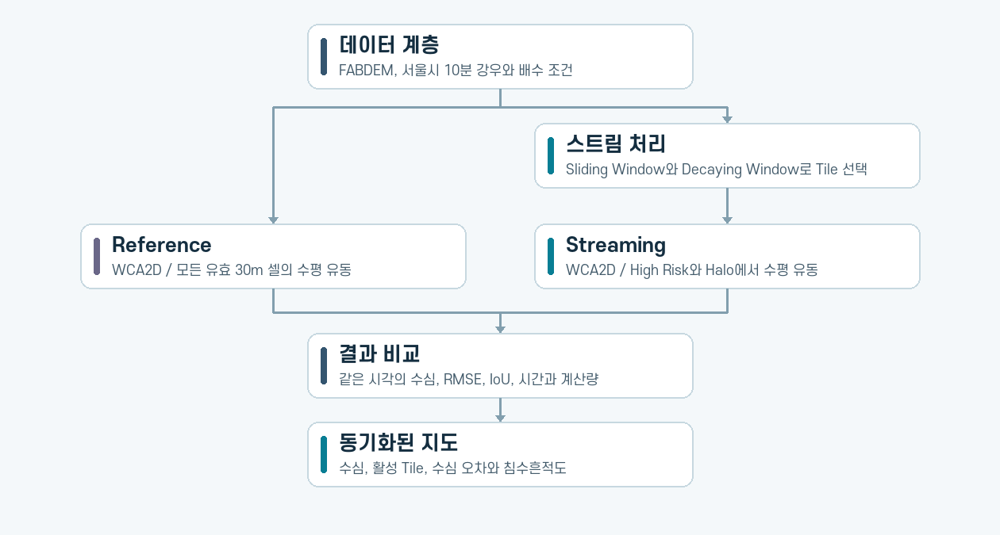

# 시스템 아키텍처

## 데이터와 계산 영역

FABDEM 두 타일을 합쳐 EPSG:5181의 30m 격자로 투영한다. 기본 영역은 SGIS의 서울시 경계에 격자 축마다 25셀(750m)을 더한 연속 영역이다. 지도에 행정경계와 실제 계산 영역을 별도로 표시한다. 각 셀에는 12km 안의 가장 가까운 서울시 관측소가 기록한 10분 강우를 일정한 비율로 적용한다. 필요한 관측소의 기록이 하나라도 빠지면 해당 구간을 건너뛰고 시나리오를 나눈다.

격자 중심을 좌표로 나눠 100m Tile을 만들며, Tile을 넘는 30m 셀 간 이웃 관계를 유지한다. 배수율 기본값은 5mm/h로 가정한다. 열린 외곽에서는 바깥의 유효한 DEM 표고를 기준으로 유출을 계산한다.

## Reference와 Streaming

두 모드는 동일한 CADDIES WCA2Dv1 유출 커널, 초기 수심 0, 배수와 외곽 조건, 15초 상한의 공통 물리 시간 간격 규칙을 사용한다. OpenMP는 한 프로세스 안에서 셀 계산을 병렬 처리한다.

- **Reference**는 물리 단계마다 모든 유효 셀에서 수평 유동을 계산한다. 동일 모델의 전체 격자 수치 기준이다.
- **Streaming**은 관측소별로 6개 구간의 Sliding Window와 계수 0.8의 Decaying Window를 갱신한다. Tile에 관측소가 여럿이면 각 지표에서 최댓값을 사용한다. 현재 강우 5mm, 60분 누적 15mm, 감쇠 점수 8mm, 잔류 수심 10mm 중 기준을 충족하면 High Risk로 분류한다. 고위험 인접 Tile과 직전 단계에서 비활성 상태로 유입을 받은 Tile은 Halo로 분류한다. 이 값은 계산 정책의 초기 설정이다.

엔진은 건조하고 비가 없는 셀을 제외하고 강우와 배수를 반영한다. Streaming에서는 High Risk와 Halo에서 수평 유출을 계산한다. 각 유효 셀은 현재 단계의 활성 이웃에서 들어오는 유량을 모두 더한다. 단계 사이의 OpenMP 동기화와 셀별 쓰기 범위로 이전 유출량 재사용과 중복 갱신을 막는다. 수량 보존은 강우, 배수, 외곽 유출과 남은 물의 차이로 검증한다.

## 저장과 비교

한 실행 작업이 Reference와 Streaming을 순차 실행한다. 데이터 배열과 강우, 격자, 물리·스레드 설정, 실행 환경과 엔진이 일치하면 완료된 Reference를 재사용한다. 각 10분 구간의 종료 시각에 수심 배열을 저장하고 정확히 같은 시각끼리 비교한다. 계산 시간에는 강우·Window·Tile 선택과 물리 단계를 포함한다. 저장 및 비교 시간은 별도 기록하며 PNG는 요청 시 렌더링한다.

RMSE는 전체 유효 셀과 두 결과의 침수 셀 합집합에서 각각 산출한다. 침수는 수심 5cm 이상으로 정의한다. IoU는 침수 셀 합집합이 비어 있으면 미정의다. 오차 지도는 Streaming 수심에서 Reference 수심을 뺀 결과를 표시한다.

침수흔적도는 8월 8~9일에 시작한 기록을 표시한다. 사건 최대 모의 수심이 5cm 이상인 셀이 기록 폴리곤의 합집합과 겹치는 비율을 두 모드에서 계산한다. 기록 범위는 실제 연속 수심이나 전체 미침수 범위를 나타내지 않으며, 서울 기본 강우 시나리오의 시간 범위와도 다르다.

## 화면과 제어

FastAPI는 저장된 배열과 지표를 읽고 MapLibre는 같은 카메라와 공통 시간 막대를 공유하는 두 지도를 표시한다. 지도에서 Tile을 선택하면 실제 강우와 두 Window, 계산 정책, 활성화 조건과 마지막 수평 유동 시각을 확인할 수 있다. Solar는 현재 실행의 결과를 읽는 보조 기능이다.
